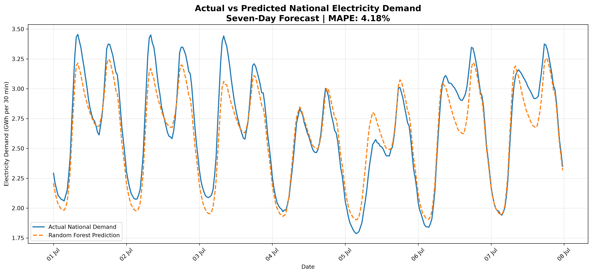
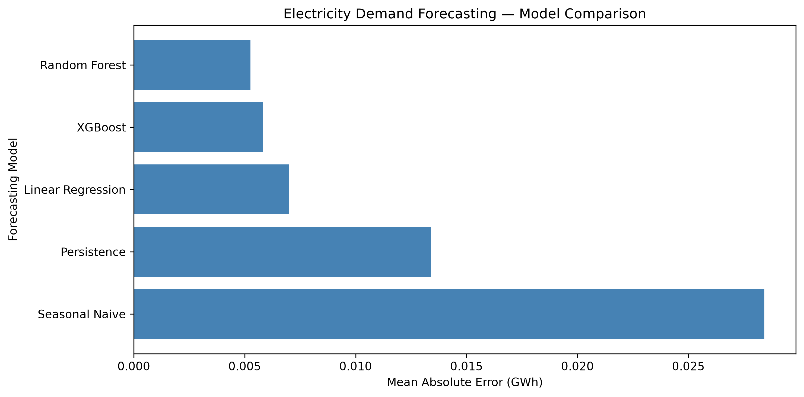
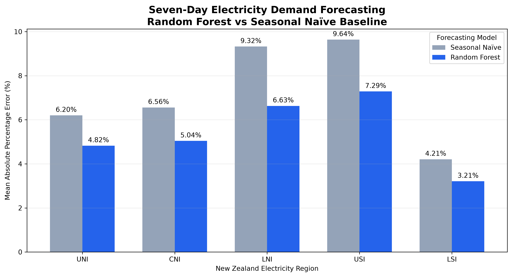
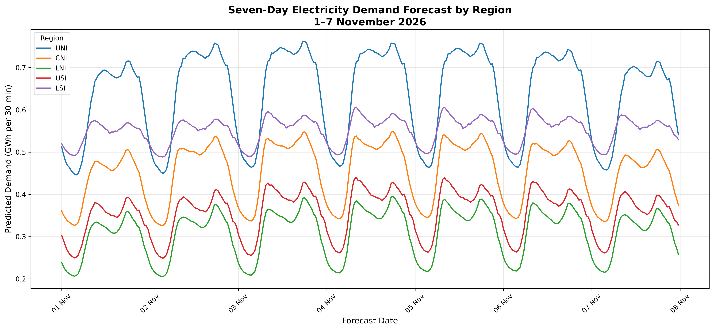
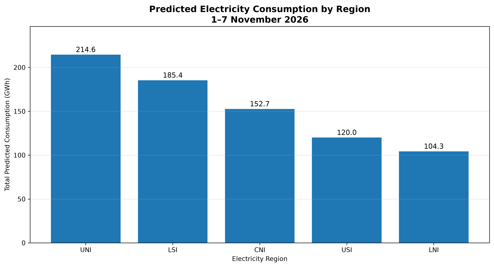

# New Zealand Electricity Demand Forecasting

**End-to-end data science project | Python · Time-series analysis · Random Forest · XGBoost · Multi-output regression**

Forecasting half-hourly electricity demand across New Zealand's five electricity regions, from exploratory analysis and feature engineering to model comparison, seven-day regional forecasts, national aggregation, and exportable future predictions.

> **Headline result:** The combined regional Random Forest models achieved **4.19% national MAPE** over 82 aligned seven-day test forecast windows, versus **5.50%** for a seasonal naïve baseline (**23.86% relative MAPE reduction**). These are historical evaluation results, not a guarantee of future accuracy.



## Contents

1. [Research questions](#research-questions)
2. [Data and preparation](#data-and-preparation)
3. [Exploratory analysis](#exploratory-analysis)
4. [Feature engineering](#feature-engineering)
5. [Short-horizon model comparison](#short-horizon-model-comparison)
6. [From recursive to multi-output forecasting](#from-recursive-to-multi-output-forecasting)
7. [Seven-day regional forecasting](#seven-day-regional-forecasting)
8. [National aggregation and evaluation](#national-aggregation-and-evaluation)
9. [Future forecasts: 1–7 November 2026](#future-forecasts-17-november-2026)
10. [Repository guide](#repository-guide)
11. [Reproducing the analysis](#reproducing-the-analysis)
12. [Limitations and next steps](#limitations-and-next-steps)

## Research questions

- What seasonal, daily, weekly, and regional patterns appear in New Zealand electricity demand?
- How well do calendar features and historical demand lags predict the next half-hour of consumption?
- How do linear regression, Random Forest, and XGBoost compare against simple forecasting baselines?
- Can direct multi-output regression improve 24-hour and seven-day forecasts compared with recursive prediction?
- Which historical lookback window works best for each electricity region?
- Can independently trained regional models be combined to forecast national electricity demand?

## Data and preparation

The project uses historical electricity demand observations for five New Zealand electricity regions, at approximately **30-minute intervals**, covering **November 2024–October 2026**. The original export also included a monetary demand measure (`Demand ($)`), examined in the exploratory analysis; the forecasting target is **`Demand (GWh)`**, energy consumed within each trading period.

| Region ID | Region |
|---|---|
| UNI | Upper North Island |
| CNI | Central North Island |
| LNI | Lower North Island |
| USI | Upper South Island |
| LSI | Lower South Island |

**Cleaning and validation:**

- Imported the source CSV after skipping **11 metadata lines** and parsed trading-period timestamps.
- Examined data types, descriptive statistics, missingness, and missing values by region.
- Identified **264 rows** with missing demand values among **175,200** initial observations (**0.151%**); removed these to produce **174,936 cleaned observations**.
- Checked for duplicate region/timestamp combinations and investigated **125 irregular time intervals**.
- Examined daylight-saving and unusual market timestamps, including **02:40 and 02:50** observations around the April 2025 clock change.
- Exported the cleaned data as `data/electricity_demand_clean.csv`.

**Source note:** The analysis uses the original electricity demand export stored under `data/`. Consult its embedded metadata for the exact source and extraction details; this README does not independently verify a public download URL.

## Exploratory analysis

**Notebook:** [`01_exploratory_data_analysis.ipynb`](notebooks/01_exploratory_data_analysis.ipynb)

The exploratory notebook studies:

- Monthly national electricity demand and winter/summer seasonality.
- Demand by hour and the characteristic overnight low and daily peaks.
- Differences in average demand across the five regions.
- National demand trends across the observation period.
- Weekday-versus-weekend demand patterns.
- Descriptive statistics for both electricity demand and monetary demand.

**Finding:** Demand is structured by season, time of day, day of week, and region. These patterns motivated calendar variables, historical lags, and separate regional models.

## Feature engineering

**Notebook:** [`02_feature_engineering.ipynb`](notebooks/02_feature_engineering.ipynb)

The feature engineering workflow creates:

| Feature group | Features |
|---|---|
| Calendar | `Hour`, `Day_of_week`, `Month`, `Weekend` |
| Trading period | `Trading_period` (0–47 on standard days) |
| Demand lags | `Demand_lag_30min`, `Demand_lag_1h`, `Demand_lag_24h`, `Demand_lag_7d` |
| Region | `Region ID` / `Region` |
| Target | `Demand (GWh)` |

Rather than blindly shifting rows, lag features are matched using **region and timestamps** to avoid confusing an available observation with the correct historical trading period when gaps occur. Missing required lags were excluded from the initial modelling dataset rather than imputed.

- Cleaned observations: **174,936**.
- Rows excluded for incomplete lag features: **2,339**.
- Final feature-engineered dataset: **172,597 rows × 13 columns**.
- Export: `data/electricity_demand_features.csv`.

## Short-horizon model comparison

**Notebook:** [`03_model_training.ipynb`](notebooks/03_model_training.ipynb)

The initial experiments predict the next **30-minute** electricity demand observation using historical lags, calendar information, and region identifiers. They use a **chronological train/test split**, with a test period from July 2026 onward, rather than random splitting.

| Model | MAE (GWh) | RMSE (GWh) |
|---|---:|---:|
| Seasonal naïve (previous day) | 0.02843 | 0.04229 |
| Persistence (previous 30 minutes) | 0.01341 | 0.01913 |
| Linear regression | 0.00700 | 0.01056 |
| **Random Forest** | **0.00525** | **0.00861** |
| XGBoost | 0.00582 | 0.00967 |

The notebook also investigates **feature importance and ablation**:

- `Demand_lag_30min` accounted for approximately **99.09%** of Random Forest's reported impurity-based feature importance.
- Removing that feature increased MAE from **0.00525** to **0.00975 GWh**, an increase of approximately **85.7%**.

**Important:** These are **one-step-ahead** experiments that use observed historical lag values. Their low errors must **not** be interpreted as performance for a genuine seven-day forecast.



## From recursive to multi-output forecasting

**Notebook:** [`04_multi_horizon_forecasting.ipynb`](notebooks/04_multi_horizon_forecasting.ipynb)

The project next explores how to predict multiple future trading periods **without using future actual demand as an input**.

### Recursive versus direct 24-hour forecasting

A recursive approach predicts one half-hour at a time, feeding its own predictions into subsequent steps. A **direct multi-output Random Forest** instead maps the previous **7 days (336 half-hours)** to the next **24 hours (48 half-hours)** in one prediction.

On the same Upper North Island forecast date (**15 July 2026**):

| Metric | Recursive Random Forest | Direct multi-output Random Forest |
|---|---:|---:|
| MAE (GWh) | 0.21856 | **0.02775** |
| RMSE (GWh) | 0.25146 | **0.03234** |
| MAPE | 25.93% | **3.69%** |

This is a **single-day comparison**, not a claim of general superiority across every date. The direct 24-hour model was also evaluated on **108 test days**.

### Seven-day forecasts: Random Forest versus XGBoost

The notebook extends direct multi-output forecasting to **336 half-hour predictions** using **14 days (672 values)** of historical demand. It evaluates **89 overlapping test forecast windows** for the Upper North Island and compares both machine-learning models with a **seasonal naïve** forecast (repeat the preceding seven days).

| Model | MAE (GWh) | RMSE (GWh) | MAPE |
|---|---:|---:|---:|
| Seasonal naïve | 0.04744 | 0.06487 | 6.26% |
| **Random Forest** | **0.03849** | **0.05249** | **4.99%** |
| XGBoost | 0.03880 | 0.05297 | 5.02% |

The Random Forest performed marginally better in this experiment; the notebook also compares model training times and error by forecast day. This motivated using Random Forest for the final regional pipeline.

## Seven-day regional forecasting

**Notebook:** [`05_regional_forecasting.ipynb`](notebooks/05_regional_forecasting.ipynb)

Five **independent multi-output Random Forest regressors** forecast the next **7 days (336 half-hour periods)** for each region. The notebook:

1. Reshapes regional observations into **48-value daily profiles**.
2. Excludes incomplete days and creates only **consecutive-calendar-day** input/output windows.
3. Tests historical input lengths of **7, 14, and 28 days**.
4. Performs exploratory comparisons and seasonal naïve benchmarking.
5. Introduces a **chronological training/validation/test strategy** to select lookback length without selecting it directly on the final test results.
6. Retrains final models on the available pre-test history and evaluates the later test period.
7. Saves models and lookback configurations, then verifies that they can be reloaded.

**Final model-selection scheme:** training before April 2026; validation from April to June 2026; final testing beginning July 2026. The selected lookbacks were **28 days** for UNI, CNI, and USI; **14 days** for LNI and LSI.

### Final regional test results

| Region | Lookback | Random Forest MAPE | Seasonal naïve MAPE |
|---|---:|---:|---:|
| UNI | 28 days | 5.13% | 6.20% |
| CNI | 28 days | 5.17% | 6.56% |
| LNI | 14 days | 6.75% | 9.35% |
| USI | 28 days | 7.43% | 9.64% |
| LSI | 14 days | **3.16%** | 4.18% |



## National aggregation and evaluation

Regional predictions and observed demand were aligned to **82 common forecast start dates**, **1 July–20 September 2026**, then summed at matching half-hourly forecast positions.

| National metric | Result |
|---|---:|
| Forecast horizon | 7 days (336 half-hour predictions) |
| Aligned forecast windows | 82 |
| MAE | **0.1119 GWh** |
| RMSE | **0.1480 GWh** |
| Random Forest MAPE | **4.19%** |
| Seasonal naïve MAPE | 5.50% |
| Relative MAPE reduction | **23.86%** |

The example seven-day national forecast starting **1 July 2026** achieved **4.18% MAPE**. The chart shows the predicted curve tracking broad daily cycles while underestimating some demand peaks.


Aggregation can offset positive and negative regional errors, but this effect was **not independently quantified**. The 82 forecast windows **overlap**, so they are not 82 independent weeks.

## Future forecasts: 1–7 November 2026

**Notebook:** [`06_future_forecasting.ipynb`](notebooks/06_future_forecasting.ipynb)

The deployment-style notebook reloads saved regional models, constructs the required latest historical inputs, generates regional forecasts, and exports results to `forecasts/regional_electricity_forecast_2026_11_01.csv`.

**Daylight-saving handling:** New Zealand's spring transition on **4 October 2026** produced **46** rather than 48 half-hour observations. To make consecutive 48-period daily profiles for model input, the notebook fills the two absent local-clock slots using **linear interpolation for forecasting input only**; the underlying source data is not rewritten.

The five models produced **1,680 regional predictions** (5 regions × 336 periods).

| Region | Forecast consumption, 1–7 Nov (GWh) | National share |
|---|---:|---:|
| UNI | 214.60 | 27.62% |
| LSI | 185.40 | 23.86% |
| CNI | 152.69 | 19.65% |
| USI | 120.05 | 15.45% |
| LNI | 104.31 | 13.42% |
| **National** | **777.05** | **100%** |

- Predicted national consumption: **777.05 GWh (0.777 TWh)** over seven days.
- Mean predicted daily national consumption: **111.01 GWh**.
- These are **model forecasts**, not observed November totals; they have **not** been validated against actual demand for that period.





## Repository guide

```text
nz-electricity-forecasting/
├── README.md
├── requirements.txt
├── .gitignore
├── data/
│   ├── Demand_trends_20261118145637.csv   # Original export
│   ├── electricity_demand_clean.csv
│   └── electricity_demand_features.csv
├── notebooks/
│   ├── 01_exploratory_data_analysis.ipynb
│   ├── 02_feature_engineering.ipynb
│   ├── 03_model_training.ipynb
│   ├── 04_multi_horizon_forecasting.ipynb
│   ├── 05_regional_forecasting.ipynb
│   └── 06_future_forecasting.ipynb
├── models/
│   ├── random_forest_UNI_7day.pkl
│   ├── random_forest_CNI_7day.pkl
│   ├── random_forest_LNI_7day.pkl
│   ├── random_forest_USI_7day.pkl
│   ├── random_forest_LSI_7day.pkl
│   ├── regional_model_config.pkl
│   └── ...                         # Earlier model experiments
├── forecasts/
│   └── regional_electricity_forecast_2026_11_01.csv
├── figures/
│   ├── model_comparison.png
│   ├── regional_forecasting_comparison.png
│   ├── national_actual_vs_predicted.png
│   ├── seven_day_regional_forecast.png
│   └── regional_electricity_contributions.png
└── src/
```

### Notebook reading order

| Notebook | Purpose |
|---|---|
| **01 — EDA** | Data ingestion, cleaning, missingness, monthly/daily/weekly/regional demand patterns |
| **02 — Feature engineering** | Timestamp validation, calendar features, lag construction, modelling CSV export |
| **03 — Model training** | One-step seasonal/persistence baselines, linear regression, Random Forest, XGBoost, importance and ablation |
| **04 — Multi-horizon** | Recursive 24-hour experiment, direct 24-hour and seven-day models, XGBoost and naïve comparisons |
| **05 — Regional** | Regional lookback selection, validation, final model evaluation, national aggregation, model persistence |
| **06 — Future forecasting** | Saved-model inference, daylight-saving adjustment, 1–7 Nov regional forecasts, export and charts |

## Reproducing the analysis

**Prerequisites:** Python 3, Jupyter, and the packages used in the notebooks (including `pandas`, `numpy`, `matplotlib`, `seaborn`, `scikit-learn`, `xgboost`, and `joblib`). The exact environment and package versions should be verified against `requirements.txt` before claiming a fully reproducible installation.

From the repository root:

```bash
python3 -m venv .venv
source .venv/bin/activate      # macOS / Linux
python -m pip install -r requirements.txt
jupyter notebook
```

Open the notebooks in numeric order and run them with the **repository root as the parent of the `notebooks/` working directory**. Several notebook cells use `Path.cwd().parent` to locate `data/`, `models/`, and `figures/`; running from a different directory may require updating paths.

**Reproduction caveats:** Some notebook sections are exploratory and were subsequently superseded by later, more rigorous experiments. Reproducing the final headline results requires following the **validation-selected final model workflow in Notebook 05**, not selecting a model based on the initial exploratory test comparison. Ensure the source dataset is available locally; review its usage terms before redistributing it. Saved `.pkl` models should only be loaded from trusted sources.

## Limitations and next steps

- **Temporal dependence:** Seven-day forecast windows overlap; error measurements across windows are correlated.
- **Test-set reuse:** Earlier exploratory experiments inspected the eventual test period. The final validation-based selection improves the methodology but does not make the test set completely untouched across the project.
- **Historical-only inputs:** Final multi-output models primarily use past demand, without explicit future temperature, holiday, or economic predictors.
- **Seasonal generalisation:** Accuracy may vary outside the historical evaluation period or during unusual demand events.
- **Regional dependence:** The five regional models are fitted independently, without explicitly learning cross-region relationships.
- **Daylight saving and missing periods:** Incomplete days are excluded when constructing training sequences; the future-forecast notebook uses a targeted interpolation for the October 2026 spring transition.
- **Uncertainty:** Point forecasts do not include prediction intervals or calibrated uncertainty estimates.
- **Deployment:** The saved-model pipeline demonstrates batch inference, not an automated production service.

Potential extensions include **weather and holiday features**, **non-overlapping rolling-origin evaluation**, **prediction intervals**, **cross-region modelling**, **automated forecast updates**, **model monitoring**, and an **interactive dashboard**.

## Skills demonstrated

`Python` · `pandas` · `NumPy` · `scikit-learn` · `XGBoost` · `Matplotlib` · `Seaborn` · `Jupyter` · `Data cleaning` · `Time-series validation` · `Feature engineering` · `Chronological evaluation` · `Baseline modelling` · `Multi-output regression` · `Forecast aggregation` · `Model persistence` · `Data visualisation`

---

**Project status:** Historical model development and evaluation complete; November 2026 forecast generated. Next steps: repository publication, reproducibility checks, and portfolio presentation.
